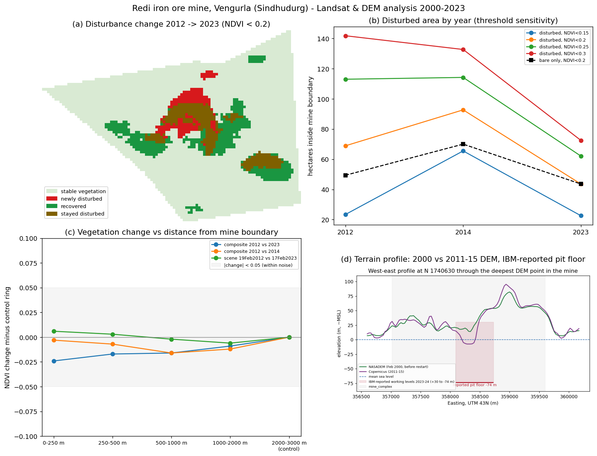

# Redi iron ore mine: disturbance, vegetation and terrain change, 2000-2023

I'm from Sawantwadi in Sindhudurg, not far from Redi (Vengurla taluka). Redi has an opencast iron ore mine about 600 m from the sea. I saw a video of a Redi local saying the pit might now be deeper than the sea next to it, and I wanted to check how the mine has actually changed using free satellite data.

This is my second pass at the project. My first version was done by clicking through ArcGIS Pro, and when I went back to check it I found a few problems (listed at the end). So I rebuilt it as Python scripts, where every number can be re-run. I used ArcGIS Pro only to draw the mine boundary and to look at the outputs.



## What I wanted to know

1. How much land inside the mine was disturbed in 2012, 2014 and 2023, and how it changed
2. Whether vegetation around the mine changed differently from vegetation further away
3. What the land looked like before the current phase of mining, and what free DEMs can show of the digging and dumping

## Data

All free and downloadable without an account.

- Landsat 7, 8 and 9 Collection 2 Level-2 (red, NIR and QA bands), from Microsoft Planetary Computer, path/row 147/049. Dry-season scenes only (Dec to Mar), for 2011-12, 2013-14 and 2022-23.
- NASADEM (reprocessed SRTM, flown Feb 2000), from Planetary Computer
- Copernicus GLO-30 DEM (2011-2015), from AWS Open Data
- `mine_complex`: the mining area boundary, which I digitized on Esri World Imagery
- Pit working levels from the Indian Bureau of Mines inspection report of 21 Nov 2024. I didn't measure these myself; they're quoted for comparison.

## How to run it

Python 3 with numpy, scipy, rasterio and matplotlib. I used my ArcGIS Pro conda environment. Run the scripts in order from the project folder:

```
python redi_download_data.py        # downloads and clips Landsat + DEMs
python 02_preprocess_ndvi.py        # reflectance scaling, masks, NDVI composites
python 03_mine_footprint_change.py  # disturbed area and change inside the mine boundary
python 04_ndvi_rings.py             # NDVI change in rings around the mine
python 05_dem_terrain.py            # slope, DEM difference, profile
python 06_summary.py                # summary table and figure
```

A few choices worth knowing about:
- Areas are calculated in UTM zone 43N (EPSG:32643), from 30 m pixels.
- Landsat Level-2 values are converted to reflectance (x 0.0000275 - 0.2) before computing NDVI.
- 2012 had only Landsat 7, whose images have striped gaps (SLC-off). I filled them by taking the median of several scenes, and adjusted the values to match Landsat 8 using Roy et al. (2016).
- "Disturbed" means NDVI below a threshold, or a pit lake. I ran everything at four thresholds (0.15, 0.20, 0.25, 0.30) to see how much the answer depends on that choice.

## Results

Full tables are in `outputs/results_summary.md`. At NDVI < 0.20:

The disturbed area inside the mine boundary went from 68.9 ha in 2012, up to 92.7 ha in 2014, then down to 43.6 ha in 2023. Between 2012 and 2023, 15.5 ha was newly disturbed, 40.9 ha became green again and 28.1 ha stayed disturbed.

So the mine did not simply keep growing, which is what I had assumed in my first version. Two things are going on together:
- Older workings to the west and around old pits have greened over. From the imagery, much of this looks like planting around old, partly flooded pits rather than natural forest.
- The active pit got bigger and much deeper. At the strictest threshold (0.15), bare ground went from about 4 ha in 2012 to about 23 ha in 2023, even though the total disturbed area barely changed.

Around the mine, every ring out to 3 km got slightly greener between 2012 and 2023. Near the mine it greened a little less than in the 2-3 km control ring (by up to 0.024 NDVI), but that pattern disappears when I compare two single scenes from nearly the same date (19 Feb 2012 vs 17 Feb 2023). I couldn't detect any vegetation decline around the mine at Landsat's 30 m scale.

The mine sits on a low laterite plateau, around 33 m above sea level on average. Comparing the 2000 and 2011-15 DEMs, about 27 ha inside the mine dropped by around 20 m (up to 39 m), and about 13 ha of dumps rose by around 19 m. Neither DEM can see the present pit floor, which IBM reported at 74 m below sea level in 2023-24.

On the original question: the pit floor (-74 m) is deeper than the seabed near Redi. The nearshore sea is only around 15 m deep at the Redi port channel. But it is nowhere near as deep as the open ocean, where the shelf edge alone is around 100 m.

## Limitations

- NDVI shows bare versus green ground, not land use. Dry-season fields look the same as mine ground, which is why I limited the analysis to a mine boundary I drew by hand.
- The 2012 baseline is built from Landsat 7 and adjusted to match Landsat 8/9. Close, but not perfectly comparable.
- Both DEMs are surface models that include tree canopy, with errors of a few metres, and water surfaces are flattened. Treat the volumes as rough.
- 30 m pixels can't pick up things like dust on leaves or a few lost trees.
- The pit depth comes from IBM reports, not from my own measurement.

## What was wrong with my first version

- I had digitized only a 2023 boundary, so there was nothing to measure growth against.
- The area came from ArcGIS's automatic Shape_Area in Web Mercator, which overstates area by about 8% at this latitude.
- The DEM layer was labelled "SRTM 2014", but SRTM was flown in Feb 2000 (2014 was only the release year).
- I hadn't documented applying the Level-2 scale factor. Without it, NDVI here comes out around 0.2 instead of about 0.6 (see `data/processed/qc_scenes.csv`).

## References

- Roy, D.P. et al. (2016). Characterization of Landsat-7 to Landsat-8 reflective wavelength and normalized difference vegetation index continuity. Remote Sensing of Environment 185, 57-70.
- USGS, Landsat Collection 2 Level-2 science products (surface reflectance scale and offset).
- Indian Bureau of Mines, Goa Regional Office. Check-up inspection report, Redi Iron Ore Mine (Block I), 21 Nov 2024.
- National Green Tribunal, O.A. No. 17/2020, joint committee inspection report on mining at Redi (2020).

Chaitanya Bandekar
